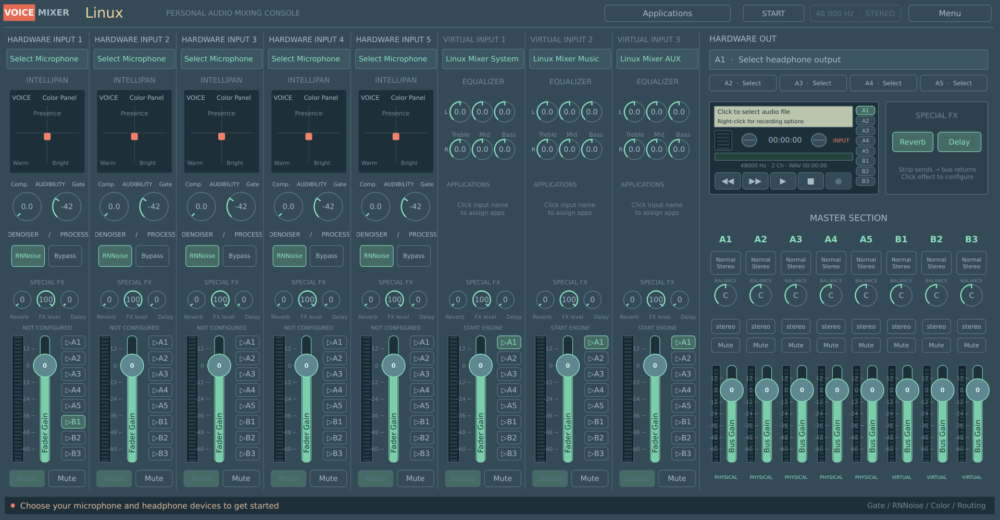
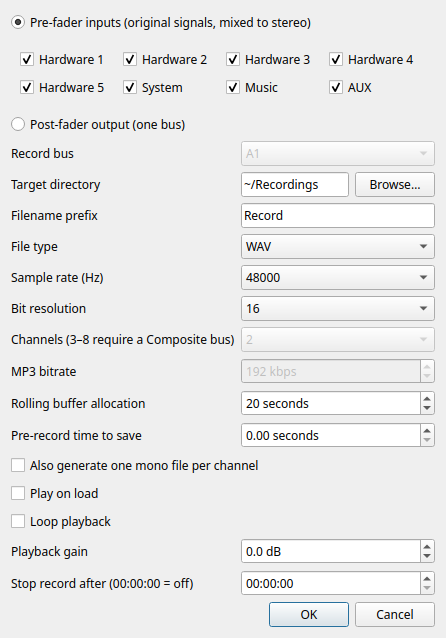
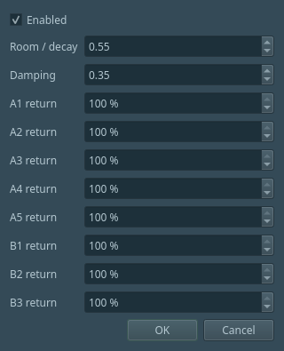

# Voicemixer

A native Linux audio mixer for PipeWire, with five hardware inputs, three virtual
app inputs, eight output buses, voice processing and a tape recorder.

**Early release:** tested on Ubuntu 26.04; the Arch build recipe is provided but
has not yet been tested on Arch. A [Gentoo/KDE source-build kit](docs/GENTOO-INSTALL.txt)
is also available and has not yet been tested on Gentoo. See [Arch setup](docs/ARCH-INSTALL.txt) and
[recorder instructions](docs/RECORDER.md). The executable and virtual devices
currently retain their `linux-mixer` / **Linux Mixer** names for compatibility.

Voicemixer is an independent project inspired by Voicemeeter Potato. It is not
affiliated with or endorsed by VB-Audio and does not contain their source code
or proprietary DSP. Original project code is licensed under GPL-3.0-or-later;
vendored components retain their own licenses and notices (see [vendor](vendor/README.md)).

## Screenshots

Actual application windows captured with a clean profile, before selecting audio
devices. The recorder example uses a generic recording folder.



| Tape recorder options | Reverb and per-bus returns |
| --- | --- |
|  |  |

A native C++/Qt personal audio console using the supplied VoiceMeeter Potato
screenshot as its layout reference. Opens maximized as a normal desktop window.
This is an independent implementation; the color mapping and DSP are our own
configuration of open-source processors, not VoiceMeeter's algorithms.

## Working features

- **Five hardware inputs**, each with its own device/channel selection, RNNoise,
  gate threshold/attack/release, compressor, color pad, bypass, gain and mute.
  Interface inputs can select a specific FL/FR/AUX channel or a mono downmix.
  Unassigned strips create no capture stream. Mic signals feed both sides of buses.
- **Three stereo app inputs**: Linux Mixer System, Linux Mixer Music, Linux Mixer
  AUX. Each has independent gain, mute and A1–A5/B1–B3 sends. As requested, virtual
  strips have no gate/compressor/denoiser buttons.
- **A1–A5 physical outputs** and **B1–B3 virtual microphones**, with independent
  mixes, master gains/mutes, actual meters, and linked stereo −1 dBFS peak limiting.
  B1 retains the device name **Linux Mixer Microphone**. B2 and B3 are **Linux
  Mixer B2** and **Linux Mixer B3**.
- **Applications** menu for moving all active streams from an app into System,
  Music or AUX. Saved rules restore new streams while the controller runs.
- **Sample-level 10 ms fades** for faders, mute/unmute, sends, and DSP wet/dry
  switching. The limiter has immediate peak reduction and an 80 ms release,
  no lookahead buffer, and shared gain reduction to preserve stereo balance.
- **Background/tray operation**: close hides the console and keeps app assignment,
  graph reconciliation and recovery running. Launch again to reopen the same
  controller. The tray offers Show, Restart, Stop, Start at login and Quit.
  A desktop without a tray can reopen it through the launcher. Quit/Stop are also
  in the main Menu. Autostart is optional and off until selected.
- **Recovery**: reconnect selected physical sources and output links after they
  return; restart crashed mixer-owned processes with bounded retry intervals.
  A stopped engine stays stopped. Settings and presets persist.

The virtual EQs, recorder, reverb/delay and master balance/mono controls are
functional in version 0.3. The recorder follows the documented tape workflow;
see [recorder controls and behavior](docs/RECORDER.md). Reverb/delay use our own
native DSP, rather than VB-Audio's proprietary FX algorithms. VBAN, ASIO, MIDI,
macro control, external FX inserts, surround upmix and full parametric master EQ
are still outside this build.

## EQ, FX and master controls

Each virtual strip has separate left/right treble, mid and bass gains (top row L,
bottom row R). Drag or scroll a knob; double-click for flat. The bands are high
shelf at 6.5 kHz, presence at 1 kHz, and low shelf at 120 Hz, with ±12 dB gain.
Strip Reverb and Delay knobs send to those effects; FX level scales both sends.
Click Reverb/Delay in Special FX for decay/damping, delay time/feedback and per-bus
returns. Effects follow that strip's bus sends. Defaults are zero sends and a dry
mix. Master BALANCE and stereo/mono buttons work on ordinary stereo buses.

The Normal mode button opens the eight-channel Composite patch used for separate
channel recording. Its pre/post selection determines whether strip processing is
included. A mode/patch change restarts audio; ordinary knob changes do not.

## Use

Run `./run-mixer.sh` from a source checkout, or use the installed Linux Mixer
launcher. Choose hardware devices under the five strip names, select headphones
under Hardware Out A1, and Start. Click a mic's input menu for individual interface
channels. Additional mic strips begin unassigned with all sends off.

A sends feed selected physical devices. B sends feed virtual microphones in other
apps. Click an unconfigured A send to select its device, then enable the send.
Strip gain/mute affects every send from that strip; master gain/mute affects only
that bus. B2/B3 are silent until you enable sends.

For Discord:

1. Input: **Linux Mixer Microphone** (B1).
2. Output: **Linux Mixer AUX**.
3. Mic strip: B1 on, A1 off to avoid hearing yourself.
4. AUX strip: A1 on, B1 off to avoid sending friends' voices back to them.

Use Applications → app → destination, or select a virtual output inside the app.
Play audio first if an app is absent from the list. Forgetting a saved assignment
returns its active streams to the system default. JACK/ALSA-exclusive apps can
require manual graph routing. No system audio default is changed.

Gate: drag/scroll threshold; right-click for timing on that strip. Comp. raises
ratio and lowers threshold without makeup gain. Color: left adds warmth, right
adds brightness, up adds presence. Double-click a pad to center it or a fader to
reset it to 0 dB. Bypass retains fader/mute while skipping the effects.

Device changes or engine restarts briefly recreate virtual devices and can
interrupt playback, including Spotify. Normal faders, effects and sends update
without recreating devices. The peak limiter protects sample peaks; it is not
an oversampled true-peak limiter. Gate/compressor/color parameter changes are
not all internally smoothed; gain, routing and wet/dry transitions are smoothed.

## Build and installation

**Audio server:** PipeWire, WirePlumber and `pipewire-pulse` are required.
PulseAudio applications work through PipeWire's compatibility service; a
standalone PulseAudio server is not supported. In Konsole/Terminal, `pactl info`
should identify the server as **PulseAudio (on PipeWire …)**. Having `pulseaudio`
and `pipewire` in Gentoo's USE flags does not establish which server is running.

Requirements: CMake 3.20+, Ninja, C/C++17 compiler, Qt 6 Core/Gui/Widgets development
files, and a working PipeWire/WirePlumber session. RNNoise is built from the pinned
v1.10 source included in `vendor/`, without network access during compilation.
The original upstream sources and licenses are included. The optional `.deps/sdk`
fallback is only for this development machine and is not distributed.

Ubuntu build/runtime packages:

```bash
sudo apt install build-essential cmake ninja-build qt6-base-dev qt6-wayland \
  pipewire pipewire-bin pipewire-pulse wireplumber pulseaudio-utils ffmpeg zam-plugins
./run-mixer.sh
```

Arch:

```bash
sudo pacman -S --needed base-devel cmake ninja qt6-base qt6-wayland \
  pipewire pipewire-audio pipewire-pulse wireplumber libpulse ffmpeg zam-plugins-ladspa
./run-mixer.sh
```

For a normal install:

```bash
cmake -S . -B build -G Ninja -DCMAKE_BUILD_TYPE=Release -DCMAKE_INSTALL_PREFIX=/usr
cmake --build build -j2
sudo cmake --install build
```

## Send to a friend

`python3 packaging/release.py` creates release files in `dist/` using an explicit
source allowlist. Personal settings, device names, app rules, runtime logs, local
SDK files and unrelated user files are excluded.

- **Ubuntu 26.04 amd64**: send the generated `.deb` plus the matching source
  archive. Install with `sudo apt install ./linux-mixer-*.deb` so apt resolves
  runtime dependencies. This build depends on Ubuntu 26.04's Qt libraries and
  should not be advertised as a universal Ubuntu binary.
- **Arch**: send the `dist/arch/` folder containing PKGBUILD and the checksummed
  source archive. Your friend runs `makepkg -si` there to build and install an
  Arch-native `.pkg.tar.zst`. This recipe is prepared but has not been executed
  on Arch yet. The official LADSPA package is `zam-plugins-ladspa`.
- **Gentoo/KDE**: download the Gentoo ZIP from the 0.3.2 release, extract it and
  open `INSTALL.txt`. It includes the matching 0.3.2 source, dependency/USE
  requirements, PipeWire checks and a per-user build/install helper. It is a
  manual source installation, not a prebuilt binary or Portage ebuild, and has
  not been tested on Gentoo. Generate it with `python3 packaging/gentoo/bundle.py`
  after producing the matching release source archive.
- **Other Ubuntu releases**: build from the source archive on that release,
  then run the release script to produce a package linked to that system's Qt.
  Ubuntu 24.04 and other releases have not yet been validated.

The package installs the binary, compiled DSP/RNNoise plugins, desktop launcher,
icon and licenses. First run starts with fresh settings; your friend chooses
his own devices. Installed settings live under the per-user Qt config directory
(usually `~/.config/PersonalAudio/Linux Mixer/`). The development checkout keeps
`settings.json` and `.runtime/` locally. `LINUX_MIXER_STATE_DIR` overrides this for
tests. The executable no longer embeds the developer's source-folder path.

The source archive contains all vendored source and build instructions for the
shipped RNNoise binary. Keep it alongside the binary when sharing. A portable
AppImage has not been built; native packages fit the required PipeWire tools and
LADSPA dependencies better for this first release.

## Updating

Download the newer ZIP for your distribution from GitHub Releases and extract it
into a fresh folder. First use **Menu → Quit mixer and stop audio**, or the tray
Quit action; closing the window only hides it and leaves the old version running.

- **Ubuntu 26.04:** install the new `.deb` with `sudo apt install ./linux-mixer-*.deb`.
- **Arch:** run `makepkg -si` in the new ZIP's extracted folder.
- **Gentoo:** run `bash build.sh --install` in the new ZIP's extracted folder,
  using the same installation prefix as before.

Launch Linux Mixer again afterward. Installed per-user settings are kept in the
same location; do not delete them during an update. There is no automatic updater.

## Validation and limits

Tested here: Ubuntu 26.04, PipeWire 1.6.2, Qt 6.10.2 and a Razer Seiren Mini.
Five simultaneous hardware chains are exercised with virtual interfaces; five
physical microphones and an Arch machine were not available for testing.

```bash
ctest --test-dir build --output-on-failure
python3 tests/verify_matrix.py
python3 tests/verify_hardware.py
python3 tests/measure_latency.py
python3 tests/verify_eq_fx.py
QT_QPA_PLATFORM=offscreen ./build/linux-mixer --recorder-test
QT_QPA_PLATFORM=offscreen ./build/linux-mixer --app-routing-test
QT_QPA_PLATFORM=offscreen ./build/linux-mixer --smoke-test
```

The DSP check covers interrupted fades, stereo overload and non-finite input.
Isolated tone tests check five hardware feeds, three stereo inputs, independent
bus mixes, no mic in A1 by default, channel separation, device-channel selection,
per-strip gain/mute, silence/suspension during disconnect and reconnection.
The synthetic graphs have no speaker connections and never fall back to hardware.
The integration checks verify app assignments and UI events against actual DSP
parameters and restore saved settings. They require the controller window to
be quit, not merely hidden. `./build/linux-mixer --quit-running` closes that
controller while leaving audio graphs running; the normal launcher reopens it.

`python3 tests/verify_recovery.py --live` deliberately kills only verified
mixer-owned mic/matrix processes and confirms recovery plus unchanged settings.
It briefly interrupts apps and should only be run when that is acceptable.
The normal Stop action is also checked separately against unwanted restart.

The latency script measures sample displacement between a generated reference
and the matrix output recorded on synchronized channels. Here it found no extra
whole-buffer delay in eight trials at 48 kHz. This **does not measure total mic
latency**: ADC/DAC, RNNoise, microphone DSP, application buffers, networking and
headphones are excluded. A physical end-to-end test needs a loopback connection.
No global PipeWire quantum or scheduling setting is changed by the app or tests.

## Architecture and files

Five mono hardware DSP chains plus three stereo app strips feed an 8×8 bus mixer.
Hardware strips are processed with RNNoise, ZamGate, low/presence/high shelves,
ZamComp, bypass and a fader. Each bus sums eight stereo pairs, applies its own
master fader and peak limiter, then feeds hardware or a virtual mic. Processing
runs in native PipeWire filter chains, separately from the Qt controller. Python
is used only for development checks and packaging.

`native/` holds the application and sample processors. `vendor/` holds RNNoise.
`packaging/` holds install assets and release tooling. `.runtime/` holds generated
configs, owned-process PID files, locks and logs. Meter samples are held in memory;
the recorder writes files only when REC is pressed. Internal processed sources belong to the
engine; choose B1/B2/B3 in voice apps. `mixer.py` is the obsolete initial prototype
and does not control this full mixer.

Relevant upstream details: [PipeWire filter chains](https://docs.pipewire.org/page_module_filter_chain.html),
[WirePlumber stream state](https://pipewire.pages.freedesktop.org/wireplumber/daemon/configuration/stream.html),
and [Arch LADSPA dependency](https://archlinux.org/packages/extra/x86_64/zam-plugins-ladspa/).
